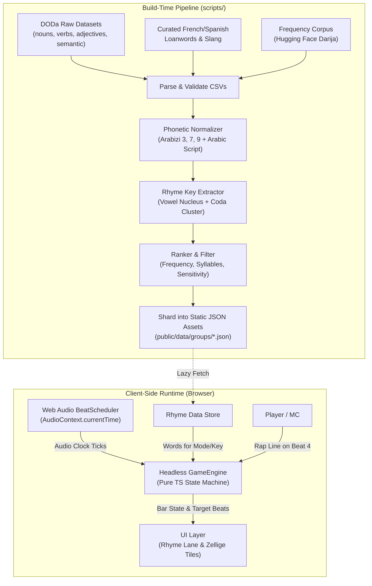

# 9afiya (قافية) Architecture Specification

**Version:** 1.0.0  
**Status:** Approved for Implementation  
**Last Updated:** November 2026  

---

## 1. Executive Summary & Product Goals

**9afiya** (قافية) is a browser-based freestyle rap training game and rhyme engine for Moroccan Darija (الدارجة المغربية). The application challenges players to rap bars in rhythm with hip-hop and traditional Moroccan beats, landing punchline rhymes on beat 4 of every bar.

### Core Architecture Pillars:
1. **Static-First & Edge-Deployable**: Zero runtime database required for Phases 1 & 2. Static JSON assets, client-side sound synthesis, and aggressive offline caching allow instant loading on mobile devices across Moroccan 3G/4G/5G networks.
2. **Sub-Millisecond Beat Timing**: Web Audio API lookahead scheduler driven strictly by hardware `AudioContext.currentTime`, completely eliminating JavaScript `setInterval` drift.
3. **Phonetic-Based Darija Rhyme Engine**: Rhymes computed by phonetic sound patterns rather than ambiguous letter spelling, recognizing both Arabizi (numbers like 3, 7, 9) and Arabic script (`ع`, `ح`, `ق`).
4. **Future-Proof Headless Game Core**: Game state machine, bar progression, score keeping, and rhyme matching isolated in a pure TypeScript module (`src/lib/game`) with no DOM or Web Audio dependencies, designed for drop-in transition to networked multiplayer rooms.
5. **Authentic Moroccan Aesthetic**: Distinct visual identity (Zellige tile lock system, Majorelle blue, saffron, terracotta, and deep teal) with mobile-first responsive design, bi-directional (LTR/RTL) rendering, and full accessibility.

---

## 2. Technology Stack & Decision Matrix

| Layer | Technology | Decision Rationales & Trade-offs |
| :--- | :--- | :--- |
| **Framework** | **Next.js (App Router) + TypeScript** | React Server Components for SEO and documentation routes (`/learn`, `/about`), static site generation (`output: 'export'` compatible where needed), strict TypeScript type safety across phonetic data models and game state machines. |
| **Styling** | **Tailwind CSS v3/v4** | Zero-runtime CSS, native CSS variable theming for dark/light Moroccan palettes, mobile-first utility classes, full RTL support via `rtl:` variants. |
| **Audio Engine** | **Web Audio API** | Native low-latency audio hardware clock (`AudioContext.currentTime`). Capable of scheduling audio events ahead of time, handling gain/filter nodes, and synthesizing procedural percussion (darbouka, krakeb, kicks, snares). |
| **State Management** | **Zustand** | Minimal boilerplate (under 2KB), clean decoupling from React component lifecycles, easy persistence via `localStorage` with fail-safe error wrapping. |
| **Rhyme Pipeline** | **Node.js / TS Build Script** | Build-time precomputation converts ~150,000 raw DODa entries into compact indexed JSON dictionaries split by rhyme key. No expensive runtime NLP on low-end mobile devices. |
| **Testing** | **Vitest & Playwright** | Vitest for instantaneous unit testing of phonetic transformations, audio scheduling math, and game state transitions; Playwright for cross-browser testing of real audio playback and touch interactions. |
| **PWA & Offline** | **Workbox / Service Workers** | Cache app shell, precomputed rhyme shards, and beat audio files. Enables full freestyle cyphers without cellular data. |
| **Backend (Phase 3)**| **Supabase (PostgreSQL + Auth)** | Lightweight backend-as-a-service for community rhyme submissions, word reporting, moderation dashboard, and global leaderboards. Zero footprint in Phases 1 & 2. |

---

## 3. System Architecture & Folder Structure

```
9afiya/
├── .github/
│   ├── workflows/            # CI/CD: lint, typecheck, test, build
│   ├── ISSUE_TEMPLATE/       # Bug report, feature request, word correction
│   └── PULL_REQUEST_TEMPLATE.md
├── docs/                     # Product specs, release notes, guides
├── data/
│   ├── raw/                  # Source CSVs from DODa & frequency lists (.gitignore)
│   └── build/                # Intermediate build cache
├── public/
│   ├── beats/                # Audio loops (MP3/OGG) + beats.json metadata
│   ├── data/                 # Chunked static rhyme indexes (loaded on demand)
│   │   ├── rhymes-index.json # Master lookup table (word -> phonetic key)
│   │   ├── groups/           # Sharded rhyme groups (e.g., ar.json, ayn.json)
│   │   └── themes.json       # Curated topic cypher dictionaries
│   └── icons/                # Favicon and PWA manifest icons
├── scripts/
│   ├── fetch_doda.py         # Automated dataset download & validation
│   ├── build_rhyme_index.ts  # Normalization, phonetic key generation & sharding
│   └── verify_rhymes.ts      # Automated verification of 30+ canonical rhyme pairs
├── src/
│   ├── app/                  # Next.js App Router
│   │   ├── layout.tsx        # Root layout with font configuration & metadata
│   │   ├── page.tsx          # Homepage: Hero with live playable demo
│   │   ├── play/
│   │   │   └── [mode]/       # Game screen (Classic, Topic, Code-Switch, etc.)
│   │   ├── lab/              # Rhyme Lab search engine
│   │   ├── daily/            # Daily challenge view with streak counter
│   │   ├── beats/            # Beat library with attribution and BPM filter
│   │   ├── learn/            # Darija rap guides, rhyme theory, writing
│   │   ├── submit-beat/      # Producer submission guidelines
│   │   └── legal/            # Privacy, Terms, Data Credits
│   ├── components/           # Reusable UI components
│   │   ├── game/             # Game screen, RhymeLane, ZelligeTile, BeatBar
│   │   ├── audio/            # AudioPlayer, TapTempo, BpmSlider
│   │   ├── common/           # Button, Modal, ScriptToggle, LanguageSelector
│   │   └── visualizer/       # Accessible visual beat pulse & canvas effects
│   ├── config/               # App configuration (site name, defaults, palettes)
│   │   └── site.ts           # Single source of truth for app title & metadata
│   ├── lib/
│   │   ├── audio/            # Audio engine: lookahead scheduler & synth
│   │   │   ├── BeatScheduler.ts
│   │   │   ├── ProceduralBeats.ts
│   │   │   └── SoundManager.ts
│   │   ├── game/             # PURE TypeScript game logic (Injectable time source)
│   │   │   ├── GameEngine.ts
│   │   │   ├── BarManager.ts
│   │   │   └── Scoring.ts
│   │   ├── rhyme/            # Rhyme engine
│   │   │   ├── normalizer.ts
│   │   │   ├── rhymeKey.ts
│   │   │   └── ranker.ts
│   │   ├── i18n/             # Translations (en, fr, ary-Latn, ary-Arab)
│   │   └── storage/          # LocalStorage wrappers with try/catch
│   ├── store/                # Zustand client state stores
│   │   ├── useGameStore.ts
│   │   ├── useAudioStore.ts
│   │   └── useSettingsStore.ts
│   └── types/                # Core TypeScript interfaces
│       ├── audio.ts
│       ├── game.ts
│       └── rhyme.ts
├── ARCHITECTURE.md
├── DATA_SOURCES.md
├── BEAT_LICENSES.md
├── README.md
└── package.json
```

---

## 4. End-to-End Data Flow Pipeline



---

## 5. Web Audio Timing & Lookahead Scheduler

JavaScript timing primitives (`setTimeout`, `setInterval`) are notoriously inaccurate in web browsers due to event loop starvation, garbage collection pauses, and tab throttling. A freestyle rhythm tool cannot afford timing jitter.

### The Lookahead Architecture
We employ the **Chris Wilson Lookahead Audio Scheduling** paradigm:
1. **Hardware Timebase**: All audio events are scheduled strictly against `audioContext.currentTime` (hardware-driven, double-precision float in seconds).
2. **Scheduler Worker/Timer**: A lightweight JavaScript interval runs frequently (e.g., every `25ms`).
3. **Lookahead Window**: On each tick, the scheduler inspects the next `100ms` (`scheduleAheadTime = 0.100s`). Any beat, kick, snare, or metronome click falling within this forward window is dispatched immediately to the Web Audio audio graph with an exact future timestamp:
   $$\text{targetTime} = \text{barStartTime} + (\text{beatIndex} \times \text{secondsPerBeat})$$
4. **Visual Synchronization**: Since DOM updates cannot run ahead of time, visual elements (the rhyme lane and zellige tiles) subscribe to `requestAnimationFrame` and interpolate position using the current delta:
   $$\text{progress} = \frac{\text{audioContext.currentTime} - \text{barStartTime}}{\text{barDuration}}$$
   This ensures that even if a frame drops in the UI, the audio remains sample-accurate, and the visual tile snaps into place on beat 4.

### Beat Quantization & Bar Lifecycle (AABB)
```
Bar 1 (Sound A): [Beat 1: Prepare] -> [Beat 2: Rhyme tile enters] -> [Beat 3: Delivery] -> [Beat 4: PUNCHLINE A]
Bar 2 (Sound A): [Beat 1: Prepare] -> [Beat 2: Rhyme tile enters] -> [Beat 3: Delivery] -> [Beat 4: PUNCHLINE A]
Bar 3 (Sound B): [Beat 1: Prepare] -> [Beat 2: Rhyme tile enters] -> [Beat 3: Delivery] -> [Beat 4: PUNCHLINE B]
Bar 4 (Sound B): [Beat 1: Prepare] -> [Beat 2: Rhyme tile enters] -> [Beat 3: Delivery] -> [Beat 4: PUNCHLINE B]
```

---

## 6. Phonetic Rhyme Algorithm for Darija

Because Moroccan Darija has no singular standardized orthography and combines Semitic Arabic roots with Berber (Amazigh), French, and Spanish phonology, rhyming purely by letters causes severe false negatives and false positives.

### Normalization Rules
1. **Arabizi Number Mapping**:
   - `3` $\rightarrow$ `ع` (`'`)
   - `7` $\rightarrow$ `ح` (`ħ`)
   - `9` $\rightarrow$ `ق` (`q`)
   - `8` $\rightarrow$ `ه` (`h`)
   - `5` or `kh` $\rightarrow$ `خ` (`x`)
   - `2` $\rightarrow$ `ء` (`ʔ`)
   - `gh` $\rightarrow$ `غ` (`ɣ`)
   - `ch` / `sh` $\rightarrow$ `ش` (`ʃ`)
2. **Vowel Merging**:
   - Short vowels in Darija are often elided or reduced to schwa (`e`).
   - Long vowels: `aa` $\rightarrow$ `a`, `ee` / `iy` $\rightarrow$ `i`, `oo` / `ou` $\rightarrow$ `u`.
   - Diphthongs: `ay` / `ey` $\rightarrow$ `ay`, `aw` / `au` $\rightarrow$ `aw`.
3. **Coda & Nucleus Extraction**:
   - For **closed syllables** (ending in consonants): Rhyme key is the last vowel nucleus + coda cluster. Example: `dar`, `nhar`, `jar` $\rightarrow$ `-ar`.
   - For **vowelless consonant clusters** (Darija monosyllables like `drb`, `hrb`): We extract the final consonant coda with implicit vowel nucleus. Example: `drb`, `hrb` $\rightarrow$ `-erb`.
   - For **open syllables** (ending in vowels like `tabla`, `9ahwa`): Rhyming on simply `-a` is too broad; our engine extracts the preceding consonant coda + vowel (`-la`, `-wa`), matching authentic rap conventions.

---

## 7. Future-Proofing for Online Multiplayer

While online play is reserved for post-Phase 3, rewriting an audio/game loop for network synchronization is painful if built with tight UI couplings. We protect against this from day one:
1. **Headless `GameEngine`**: The engine in `src/lib/game/GameEngine.ts` maintains pure state (current bar, current beat, active words, turn queue, scores). It has no `window`, `document`, or `AudioContext` imports.
2. **Injectable Clock Interface (`TimeSource`)**:
   ```typescript
   export interface TimeSource {
     getCurrentTime(): number;
   }
   ```
   In single-player, `WebAudioTimeSource` provides `audioContext.currentTime`. In future multiplayer, `NetworkSyncedTimeSource` (using NTP-style clock synchronization against a server timestamp) can be injected without altering game logic.

---

## 8. Risk Assessment & Mitigation Strategies

| Risk | Impact | Severity | Mitigation Strategy |
| :--- | :--- | :--- | :--- |
| **Mobile Audio Autoplay Policies** | Audio fails to play until user interaction on iOS/Android. | High | Display an explicit, engaging "Tap to Enter Cypher" splash screen that initializes and resumes the `AudioContext` inside a direct `pointerdown` event handler. |
| **iOS Web Audio Suspension / Mute Switch** | iOS devices mute Web Audio if the hardware silent switch is engaged. | Medium | Use an HTML5 `<audio>` unlock buffer trick to route audio through the ambient/playback channel, and provide visual on-screen alerts if audio context state is `suspended`. |
| **Audio Drift over 5+ Minutes** | Rhyme tiles and beats fall out of sync over extended sessions. | Critical | Rely solely on `audioContext.currentTime` lookahead scheduling. Continuously calibrate UI animation position against the hardware audio clock. |
| **DODa License Restriction (CC BY-NC 4.0)** | Dataset is strictly non-commercial without explicit permission. | High | Document clearly in `DATA_SOURCES.md`; include full citation and attribution; maintain zero ads/monetization in the codebase; supply contact templates for author licensing. |
| **High Network Latency on Mobile** | Users experience slow downloads of audio and large dictionaries. | Medium | Compress all audio loops to high-quality mono/stereo AAC/MP3 (<1.5 MB each); shard rhyme dictionaries into small static chunks (<50 KB each) fetched on-demand. |
| **Dialectal Variation in Rhyme Acceptance** | Northern (Shamali) vs Southern/Casawi Darija pronunciations differ. | Medium | Provide dialect phonetic allowances in `src/lib/rhyme/normalizer.ts` and allow players to submit phonetic corrections via the Rhyme Lab. |
